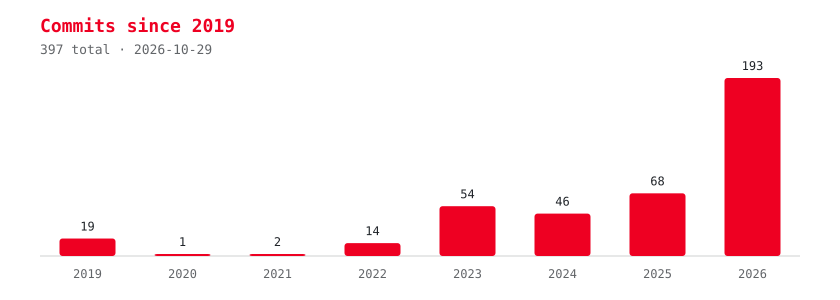

<p align="center">
  <picture>
    <source media="(prefers-color-scheme: dark)" srcset="https://shieldcn.dev/header/transparent.svg?title=AlexandreSJ&subtitle=Fullstack+developer+%C2%B7+Brazil&height=160&font=fira-code&border=false&mode=dark">
    
  </picture>
</p>

<p align="center">
  
  <a href="https://aelxand.vercel.app"></a>
</p>

<p align="center">
  <picture>
    <source media="(prefers-color-scheme: dark)" srcset="https://github-readme-stats.vercel.app/api/top-langs/?username=AlexandreSJ&layout=compact&langs_count=6&disable_animations=true&theme=transparent&hide_border=true&custom_title=Most%20used%20languages&title_color=ee0022&text_color=c9d1d9">
    
  </picture>
</p>

<p align="center">
  
</p>

```markdown
> cat who.md

# AlexandreSJ

## About me
- Fullstack developer
- Linux and Cybersecurity enthusiast (arch btw)
- D&D player
- Guitar and bass player
- I'm Brazilian and I speak:
  - Portuguese (native)
  - English (fluent)
  - Spanish (intermediate)
  - Japanese (still getting the hang of it)

## My philosophy
*I want people to thrive with me*, and to bring great
solutions to real problems. As long as it's in my control,
I'll do my best to make it happen.

> cat what.md

# What I'm up to
- building: noct, my TUI workspace/terminal multiplexer
- learning: cybersecurity, WAPT, charm.land
- graduated: BSc in Computational Science
- running: D&D campaigns as a DM

# What I'm aiming for
- finish noct
- rebuild my portfolio website
- get a WAPT certification
```

<p align="center">
  <a href="https://spotify-github-profile.kittinanx.com/api/view?uid=31qxydlur4yyxhsxfputmv56a66u&redirect=true">
    
  </a>
</p>

<h3 align="center">Links</h3>

<p align="center">
  <a href="https://aelxand.vercel.app"></a>
  <a href="https://www.linkedin.com/in/alexandre-da-silva-junior/"></a>
  <a href="https://buymeacoffee.com/aelxand"></a>
</p>

<p align="center">
  <a href="https://github.com/AlexandreSJ/noct"></a>
  <a href="https://github.com/AlexandreSJ/aoi"></a>
  <a href="https://github.com/AlexandreSJ/aoi-web"></a>
  <a href="https://aoi-online.vercel.app/"></a>
</p>
